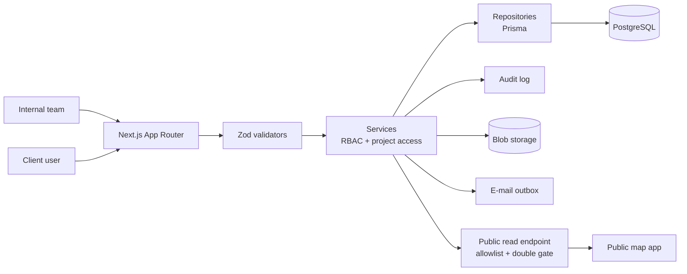

# Environmental Compliance Portal (case study)

[Português](README.md) · **English**

A multi-tenant web portal where an environmental team drafts, reviews and publishes monitoring content, and each client sees only what was published for its own projects.

Built during my work at [Toveri](https://toveri.com.br), an environmental consultancy that monitors offshore operations. Documentation only: no source code, client names, data or infrastructure identifiers.

> This repository is documentation only. The source code, data and infrastructure belong to the employer and are not published here. See [What is intentionally omitted](#what-is-intentionally-omitted).

## Problem

An environmental consultancy that monitors offshore seismic surveys has to track, per project: licence conditions and their evidence, several monitoring programs (marine fauna, passive acoustics, pollution control, crew environmental training, among others), indicators, weekly updates, documents and the spreadsheets that field teams send every week.

Two audiences read the same information with very different rights:

- the internal team needs to create, edit, review and publish;
- the client (the survey operator) must see only content that was reviewed and published for its own projects, and never another client's data, never a draft.

Before the portal this lived in e-mails, shared folders and spreadsheets, with no single place that answered "what has actually been delivered to this client, and when".

## My role

Sole developer: design, data model, implementation, tests, Azure deployment and day-to-day operation. All 309 commits in the repository (30 Jul to 18 Nov 2026, all branches) are mine. I used AI-assisted development (Claude Code) throughout; design decisions, review and production responsibility are mine.

## Architecture

- **One database, two surfaces.** Internal routes create and publish; client routes read only rows with `PUBLISHED` status and `CLIENT_VISIBLE` visibility.
- **Strict layering.** `app/` (pages, route handlers, server actions) to `validators/` (Zod contracts) to `services/` (use cases, authorization, publication) to `repositories/` (Prisma only, no presentation rules), then `AuditLog`.
- **Write path:** UI / REST / server action, then Zod, then RBAC and project-access check, then service, then repository, then audit entry, then revalidation of the client pages.
- **Data model:** 31 Prisma models and 18 migrations. Core entities (users, projects, project membership, programs, weekly updates, indicators, activities, documents, licence conditions with evidence and weekly tracking, notifications, audit log, vessel navigation plans) have full repository/service/route coverage.

## Key engineering decisions

- **Authorization is enforced in the service layer, not the UI.** The edge proxy does a route-level check, but every service and route handler re-checks role permission and project membership (`requirePermission` / `requireProjectAccess`). Project access is a many-to-many `ProjectMember` table; there is one "current project" mechanism (a cookie set through an authenticated endpoint) reused everywhere instead of parallel context systems.
- **Four roles with separated duties.** Admin, environmental team (writes content), reviewer (reviews and publishes, cannot author) and client (reads published content for linked projects).
- **Explicit publication lifecycle.** `DRAFT -> IN_REVIEW -> PUBLISHED -> ARCHIVED`. Publishing stamps `publishedAt`, writes an audit entry and revalidates client pages; later drafts stay invisible until republished.
- **One deliberately public endpoint, built as an allowlist.** A separate public map application reads vessel operation plans through an unauthenticated endpoint. It lives in its own service file with no auth imports, so its openness is visibly intentional. Rows must pass a double gate (`publicationStatus = PUBLISHED` and `publicVisibility = PUBLISHED_PUBLIC`), and the repository `select` names every returned field, so a new column cannot leak by default. The DTO shape is pinned by tests on both sides after a real contract mismatch (flat vs nested vessel object) broke the consumer silently.
- **Transactional e-mail through an outbox.** Every message is first stored with a unique deduplication key (at most one row per logical event, however often a request is retried), then sent through Microsoft Graph. Without configured credentials the row ends as `SKIPPED` and nothing leaves the server, which is the safe default for development.
- **Pluggable file storage.** A small `StorageProvider` interface (save/read/delete) with a local implementation and an Azure Blob implementation; tests run against Azurite.
- **Narrow database fallback.** Read paths on the client side use a wrapper that falls back to local reference data only on known connection, authentication, timeout or missing-schema errors, in development or demo mode. Unexpected errors propagate, and no administrative mutation ever uses the fallback.
- **Spreadsheet readers as tested, pure modules.** Field teams' weekly spreadsheets are parsed by per-program readers (exceljs), each with its own test file, instead of a generic importer.
- **In-app assistant constrained by the same authorization.** The assistant (Vercel AI SDK, tool calling) only answers through server-side tools that re-check permission and project access per call, and has a hard ceiling of four model steps per message. It never uses the public projection to answer about a specific project.
- **Empty states instead of synthetic data.** Modules without real data render an explicit empty state; demo fixtures are isolated behind a visible banner and role gate.
- **Security baseline:** bcrypt (cost 12) password hashes, JWT sessions capped at eight hours, a Content-Security-Policy header, and bilingual UI (pt-BR / en) with a custom dictionary system that keeps key parity between languages.

## Stack

- Next.js 16.2 (App Router), React 19, TypeScript, Tailwind CSS 4
- PostgreSQL, Prisma 7 (`@prisma/adapter-pg`)
- Auth.js (next-auth v5 beta): credentials provider, Microsoft Entra ID provider wired but not yet rolled out
- Zod 4, React Hook Form
- exceljs (spreadsheet parsing), unpdf (PDF text), Recharts, MapLibre GL
- Vercel AI SDK with Google and Groq providers (assistant)
- Azure Blob Storage SDK, Microsoft Graph `sendMail` (via HTTPS)
- Dev and test: Vitest, Playwright, embedded-postgres (local database), Azurite (local blob emulator), ESLint

## Testing and quality

- **67 Vitest test files** (count at the 18 Nov 2026 audit snapshot), covering services, publication workflow, authorization helpers, the public DTO, the e-mail outbox, storage providers and each spreadsheet reader. One integration test needs the local embedded Postgres and is expected to fail without it.
- **8 Playwright end-to-end scripts** used as smoke checks against a running instance.
- A GitHub Actions workflow runs lint, typecheck, unit tests and a production build on pushes to `main` and on pull requests.
- Not yet covered: end-to-end tests are scripts, not a CI-gated suite.

## Status

In production on Azure App Service (Linux, Node 22) with Azure Database for PostgreSQL and Blob Storage. The deployment history in the repository starts in August 2026. Actively developed.

Known gaps:

- 12 of the 31 models are modelled in the schema but have no application code writing to them yet.
- The `APPROVED` status exists in the enum but no code path reaches it, so in practice only admins publish.
- The spreadsheet import "analyze" endpoint previews but does not persist.
- Single sign-on with the corporate identity provider is wired but pending rollout.

## What is intentionally omitted

- **Source code.** It is the employer's property and contains domain logic specific to its contracts.
- **Client and project names, licence documents, monitoring data.** These are confidential and some are regulatory records.
- **Infrastructure identifiers** (resource names, domains, connection settings). They have no portfolio value and only increase attack surface.
- **Screenshots** of real client pages, for the same reason. Sanitized screenshots may be added later.

## Lessons and next steps

- **Deployment is manual.** Build locally, package the standalone output, upload a zip. It is documented and repeatable, but it should become a CI pipeline with a deploy approval step.
- **Branch hygiene.** Most work happens on long-lived feature branches; `main` is far behind, which weakens the CI workflow that targets it. Consolidating branches is the first next step.
- **Close the schema/code gap** (persist imports, implement the remaining models or drop them) and add the missing `APPROVED` transition.
- **Make the E2E scripts a CI-gated suite** against an ephemeral database.
- **What worked:** putting authorization in the service layer from day one, and treating the one public endpoint as an explicit allowlist with tests on the contract, made adding a second public consumer cheap and safe.

More detail on specific decisions: [docs/decisions.md](docs/decisions.md).
