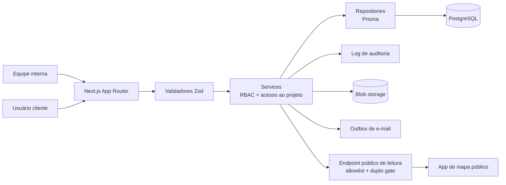

# Portal de Conformidade Ambiental (estudo de caso)

**Português** · [English](README.en.md)

Um portal web multi-tenant em que uma equipe ambiental redige, revisa e publica conteúdo de monitoramento, e cada cliente vê apenas o que foi publicado para os seus próprios projetos.

Desenvolvido durante meu trabalho na [Toveri](https://toveri.com.br), uma consultoria ambiental que monitora operações offshore. Apenas documentação: sem código-fonte, nomes de clientes, dados ou identificadores de infraestrutura.

> Este repositório contém apenas documentação. O código-fonte, os dados e a infraestrutura pertencem ao empregador e não estão publicados aqui. Veja [O que foi omitido intencionalmente](#o-que-foi-omitido-intencionalmente).

## Problema

Uma consultoria ambiental que monitora pesquisas sísmicas offshore precisa acompanhar, por projeto: condicionantes de licença e suas evidências, diversos programas de monitoramento (fauna marinha, acústica passiva, controle de poluição, treinamento ambiental de tripulação, entre outros), indicadores, atualizações semanais, documentos e as planilhas que as equipes de campo enviam toda semana.

Dois públicos leem as mesmas informações com direitos muito diferentes:

- a equipe interna precisa criar, editar, revisar e publicar;
- o cliente (a operadora da pesquisa) deve ver apenas conteúdo revisado e publicado para os seus próprios projetos, nunca dados de outro cliente e nunca um rascunho.

Antes do portal, isso ficava espalhado em e-mails, pastas compartilhadas e planilhas, sem um lugar único que respondesse "o que de fato foi entregue a este cliente, e quando".

## Meu papel

Desenvolvedor único: design, modelo de dados, implementação, testes, deploy no Azure e operação do dia a dia. Todos os 309 commits do repositório (30 jul a 18 nov 2026, todas as branches) são meus. Usei desenvolvimento assistido por IA (Claude Code) durante todo o projeto; as decisões de design, a revisão e a responsabilidade pela produção são minhas.

## Arquitetura

- **Um banco de dados, duas superfícies.** As rotas internas criam e publicam; as rotas do cliente leem apenas registros com status `PUBLISHED` e visibilidade `CLIENT_VISIBLE`.
- **Camadas rígidas.** `app/` (páginas, route handlers, server actions) -> `validators/` (contratos Zod) -> `services/` (casos de uso, autorização, publicação) -> `repositories/` (somente Prisma, sem regras de apresentação) -> `AuditLog`.
- **Caminho de escrita:** UI / REST / server action, depois Zod, depois verificação de RBAC e de acesso ao projeto, depois service, depois repository, depois registro de auditoria, depois revalidação das páginas do cliente.
- **Modelo de dados:** 31 modelos Prisma e 18 migrations. As entidades centrais (usuários, projetos, vínculo com projetos, programas, atualizações semanais, indicadores, atividades, documentos, condicionantes de licença com evidências e acompanhamento semanal, notificações, log de auditoria, planos de navegação de embarcações) têm cobertura completa de repository/service/rota.

## Principais decisões de engenharia

- **A autorização é aplicada na camada de serviço, não na UI.** O proxy de borda faz uma verificação por rota, mas cada service e route handler verifica novamente a permissão do papel e o vínculo com o projeto (`requirePermission` / `requireProjectAccess`). O acesso a projetos é uma tabela muitos-para-muitos `ProjectMember`; existe um único mecanismo de "projeto atual" (um cookie definido por um endpoint autenticado), reutilizado em todo lugar em vez de sistemas de contexto paralelos.
- **Quatro papéis com funções separadas.** Admin, equipe ambiental (escreve conteúdo), revisor (revisa e publica, não pode ser autor) e cliente (lê conteúdo publicado dos projetos vinculados).
- **Ciclo de publicação explícito.** `DRAFT -> IN_REVIEW -> PUBLISHED -> ARCHIVED`. Publicar registra `publishedAt`, grava uma entrada de auditoria e revalida as páginas do cliente; rascunhos posteriores continuam invisíveis até serem republicados.
- **Um único endpoint deliberadamente público, construído como allowlist.** Uma aplicação separada de mapa público lê planos de operação de embarcações por meio de um endpoint sem autenticação. Ele fica em um arquivo de serviço próprio, sem imports de autenticação, para que sua abertura seja visivelmente intencional. Os registros precisam passar por um duplo gate (`publicationStatus = PUBLISHED` e `publicVisibility = PUBLISHED_PUBLIC`), e o `select` do repository nomeia cada campo retornado, de modo que uma coluna nova não vaza por padrão. O formato do DTO é fixado por testes dos dois lados depois que uma divergência real de contrato (objeto de embarcação plano vs. aninhado) quebrou o consumidor silenciosamente.
- **E-mail transacional por meio de um outbox.** Cada mensagem é primeiro armazenada com uma chave de deduplicação única (no máximo um registro por evento lógico, por mais que uma requisição seja repetida) e depois enviada pelo Microsoft Graph. Sem credenciais configuradas, o registro termina como `SKIPPED` e nada sai do servidor, que é o padrão seguro para desenvolvimento.
- **Armazenamento de arquivos plugável.** Uma pequena interface `StorageProvider` (save/read/delete) com uma implementação local e uma implementação Azure Blob; os testes rodam contra o Azurite.
- **Fallback de banco de dados restrito.** Os caminhos de leitura do lado do cliente usam um wrapper que recorre a dados de referência locais apenas em erros conhecidos de conexão, autenticação, timeout ou schema ausente, em modo de desenvolvimento ou demonstração. Erros inesperados são propagados, e nenhuma mutação administrativa usa o fallback.
- **Leitores de planilha como módulos puros e testados.** As planilhas semanais das equipes de campo são processadas por leitores específicos de cada programa (exceljs), cada um com seu próprio arquivo de teste, em vez de um importador genérico.
- **Assistente no app limitado pela mesma autorização.** O assistente (Vercel AI SDK, tool calling) só responde por meio de ferramentas no servidor que verificam novamente permissão e acesso ao projeto a cada chamada, e tem um teto rígido de quatro passos de modelo por mensagem. Ele nunca usa a projeção pública para responder sobre um projeto específico.
- **Estados vazios em vez de dados sintéticos.** Módulos sem dados reais exibem um estado vazio explícito; fixtures de demonstração ficam isoladas atrás de um banner visível e de um controle por papel.
- **Baseline de segurança:** hashes de senha com bcrypt (custo 12), sessões JWT limitadas a oito horas, um cabeçalho Content-Security-Policy e interface bilíngue (pt-BR / en) com um sistema de dicionários próprio que mantém a paridade de chaves entre os idiomas.

## Stack

- Next.js 16.2 (App Router), React 19, TypeScript, Tailwind CSS 4
- PostgreSQL, Prisma 7 (`@prisma/adapter-pg`)
- Auth.js (next-auth v5 beta): provedor de credenciais; provedor Microsoft Entra ID configurado, mas ainda não liberado
- Zod 4, React Hook Form
- exceljs (leitura de planilhas), unpdf (texto de PDF), Recharts, MapLibre GL
- Vercel AI SDK com provedores Google e Groq (assistente)
- Azure Blob Storage SDK, Microsoft Graph `sendMail` (via HTTPS)
- Desenvolvimento e testes: Vitest, Playwright, embedded-postgres (banco local), Azurite (emulador local de blob), ESLint

## Testes e qualidade

- **67 arquivos de teste Vitest** (contagem no snapshot da auditoria de 18 nov 2026), cobrindo services, fluxo de publicação, helpers de autorização, o DTO público, o outbox de e-mail, os provedores de armazenamento e cada leitor de planilha. Um teste de integração precisa do Postgres embarcado local e deve falhar sem ele.
- **8 scripts end-to-end com Playwright** usados como smoke checks contra uma instância em execução.
- Um workflow do GitHub Actions roda lint, typecheck, testes unitários e um build de produção em pushes para `main` e em pull requests.
- Ainda não coberto: os testes end-to-end são scripts, não uma suíte obrigatória no CI.

## Status

Em produção no Azure App Service (Linux, Node 22), com Azure Database for PostgreSQL e Blob Storage. O histórico de deploys no repositório começa em agosto de 2026. Em desenvolvimento ativo.

Lacunas conhecidas:

- 12 dos 31 modelos estão modelados no schema, mas ainda não têm código da aplicação gravando neles.
- O status `APPROVED` existe no enum, mas nenhum caminho de código chega a ele, então na prática só administradores publicam.
- O endpoint "analyze" de importação de planilhas gera uma prévia, mas não persiste.
- O login único com o provedor de identidade corporativo está configurado, mas aguarda liberação.

## O que foi omitido intencionalmente

- **Código-fonte.** É propriedade do empregador e contém lógica de domínio específica dos seus contratos.
- **Nomes de clientes e projetos, documentos de licença, dados de monitoramento.** São confidenciais, e alguns são registros regulatórios.
- **Identificadores de infraestrutura** (nomes de recursos, domínios, configurações de conexão). Não têm valor para portfólio e só aumentam a superfície de ataque.
- **Capturas de tela** de páginas reais de clientes, pelo mesmo motivo. Capturas sanitizadas podem ser adicionadas depois.

## Lições e próximos passos

- **O deploy é manual.** Build local, empacotamento da saída standalone, upload de um zip. É documentado e repetível, mas deveria virar um pipeline de CI com etapa de aprovação de deploy.
- **Higiene de branches.** A maior parte do trabalho acontece em branches de feature de longa duração; a `main` está bem atrás, o que enfraquece o workflow de CI que a tem como alvo. Consolidar as branches é o primeiro próximo passo.
- **Fechar a lacuna entre schema e código** (persistir importações, implementar os modelos restantes ou removê-los) e adicionar a transição `APPROVED` que falta.
- **Transformar os scripts E2E em uma suíte obrigatória no CI**, rodando contra um banco efêmero.
- **O que funcionou:** colocar a autorização na camada de serviço desde o primeiro dia, e tratar o único endpoint público como uma allowlist explícita com testes sobre o contrato, tornou barato e seguro adicionar um segundo consumidor público.

Mais detalhes sobre decisões específicas: [docs/decisoes.md](docs/decisoes.md).
